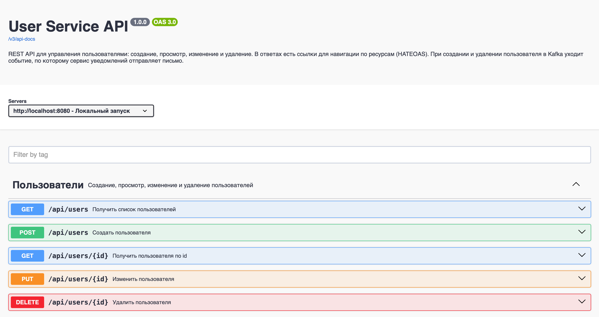
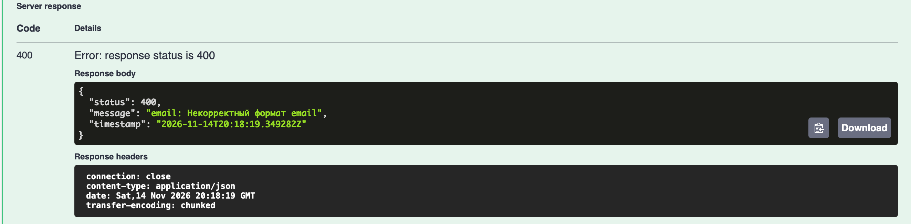

# console-app

## Состав команды

- Филиппович Милана
- Волкова Анастасия

## Домашнее задание №2

**Задание:**
Разработать консольное приложение (user-service) на Java, использующее Hibernate для взаимодействия с PostgreSQL, без использования Spring. Приложение должно поддерживать базовые операции CRUD (Create, Read, Update, Delete) над сущностью User.

**Требования:**
- Использовать Hibernate в качестве ORM.
- База данных — PostgreSQL.
- Настроить Hibernate без Spring, используя `hibernate.cfg.xml` или properties-файл.
- Реализовать CRUD-операции для сущности User (создание, чтение, обновление, удаление), которая состоит из полей: `id`, `name`, `email`, `age`, `created_at`.
- Использовать консольный интерфейс для взаимодействия с пользователем.
- Использовать Maven для управления зависимостями.
- Настроить логирование.
- Настроить транзакционность для операций с базой данных.
- Использовать DAO-паттерн для отделения логики работы с БД.
- Обработать возможные исключения, связанные с Hibernate и PostgreSQL.


## Распределение задач ДЗ №2

| Участник | Зона ответственности |
|---|---|
| Филиппович Милана | Maven, логирование, docker-compose, README, настройка Hibernate, сущность `User`, SQL-скрипт. |
| Кучугова Яна | DAO-паттерн, настройка транзакционности, кастомная обработка исключений. |
| Волкова Анастасия | Консольный интерфейс, валидация ввода, JUnit-тесты. |

## Сложности и вопросы

1. Андрей Чеботарев не вышел на связь

## Домашнее задание №3: Unit Tests

**Задание:**
Unit Tests
Написать юнит-тесты и интеграционные тесты для user-service.
Использовать JUnit 5, Mockito и Testcontainers.
Для тестирования DAO-слоя написать интеграционные тесты с использованием Testcontainers.
Для тестирования Service-слоя написать юнит-тесты с использованием Mockito.
Тесты должны быть изолированы друг от друга.


## Распределение задач ДЗ №3

| Участник | Зона ответственности                                                                              |
|---|---------------------------------------------------------------------------------------------------|
| Филиппович Милана | юнит-тесты на Mockito для сервиса, настройка инфраструктуры Testcontainers, интеграционные тесты. |
| Волкова Анастасия | рефакторинг UI, актуализация старых UI-тестов.   |

## Сложности и вопросы

1. Кучугова Яна покинула курс

## Домашнее задание №4

**Задание:**
Добавить в user-service поддержку Spring и разработать REST API для управления данными.

**Требования:**
- Использовать модули Spring (Boot, Web, Data).
- Реализовать API для получения, создания, обновления и удаления юзера (CRUD).
- Важно: Entity не должен возвращаться из контроллера, использовать DTO.
- Заменить Hibernate на Spring Data JPA.
- Написать тесты для API (MockMvc или другие средства).

## Распределение задач ДЗ №4

| Участник | Зона ответственности                                                                                                           |
|---|--------------------------------------------------------------------------------------------------------------------------------|
| Филиппович Милана | Настройка Spring Boot, создание DTO и Mapper, переписывание Service под Spring Data JPA, настройка глобальной обработки ошибок. |
| Волкова Анастасия | Удаление старых DAO, создание репозитория, создание контроллера, эндпоинты и тестов для API.                         |

## Домашнее задание №5: Kafka

**Задание:**
Реализовать микросервис (notification-service) для отправки сообщения на почту при удалении или добавлении пользователя.
Использовать необходимые модули Spring и Kafka.
При удалении или создании юзера приложение, реализованное ранее (user-service), должно отправлять сообщение в Kafka, в котором содержится информация об операции (удаление или создание) и email юзера.
Новый микросервис (notification-service) должен получить сообщение из Kafka и отправить сообщение на почту юзера в зависимости от операции:
- создание: «Здравствуйте! Ваш аккаунт на сайте ваш сайт был успешно создан.»
- удаление: «Здравствуйте! Ваш аккаунт был удалён.»

Также отдельно добавить API, которое будет отправлять сообщение на почту (тот же функционал, что и через Kafka).
Написать интеграционные тесты для проверки отправки сообщения на почту.

**Требования:**
- Использовать Spring Boot, Spring Kafka и Spring Mail.
- user-service отправляет событие в Kafka при создании и при удалении пользователя.
- notification-service получает событие из Kafka и отправляет письмо.
- В notification-service есть REST API для прямой отправки письма, без Kafka.
- Интеграционные тесты проверяют, что письмо действительно отправлено.

## Распределение задач ДЗ №5

| Участник | Зона ответственности |
|---|---|
| Филиппович Милана | docker-compose (Kafka и Mailpit), заготовка notification-service, отправка писем, приём сообщений из Kafka с ручным подтверждением, повторные попытки и отдельный топик для сломанных сообщений, интеграционные тесты Kafka. |
| Волкова Анастасия | Подключение Kafka к user-service и отправка событий при создании и удалении пользователя, REST API `POST /api/notifications` в notification-service, тесты на эти части. |

В репозитории два приложения:

```
console-app/
├── pom.xml, src/             user-service
├── docker-compose.yml        Postgres, Kafka, Mailpit
└── notification-service/     notification-service, свой pom.xml
```

| Что | Адрес |
|---|---|
| user-service | http://localhost:8080 |
| notification-service | http://localhost:8081 |
| Kafka | localhost:9092 |
| PostgreSQL | localhost:5432 |
| Mailpit, SMTP | localhost:1025 |
| Mailpit, веб-интерфейс с письмами | http://localhost:8025 |

### Сообщение в Kafka

- Топик: `user-events`.
- Ключ сообщения: email пользователя. Все события одного пользователя попадают в одну партицию, поэтому порядок событий сохраняется.
- Значение: JSON, `operation` принимает значение `CREATED` или `DELETED`.

```json
{"operation":"CREATED","email":"user@example.com"}
```

Классы события в сервисах независимы: в каждом сервисе свой `UserEvent`, общего кода нет.

### API отправки письма

`POST http://localhost:8081/api/notifications`

```json
{"operation":"DELETED","email":"user@example.com"}
```

- 200 OK, если письмо отправлено.
- 400, если email некорректный или не указана операция.

### Как notification-service читает сообщения

- Подтверждение ручное: сообщение помечается прочитанным только после того, как письмо отправлено. Если сервис упал посреди обработки, сообщение будет прочитано снова.
- Если письмо не отправилось, делаются ещё 2 попытки с паузой в 1 секунду.
- Если сообщение сломано (не JSON, нет `operation` или `email`), повторы не нужны: оно сразу уходит в топик `user-events.DLT`, а очередь продолжает работать.
- Топики `user-events` и `user-events.DLT` создаются сервисом, сообщения в них хранятся 7 дней, потом удаляются.


Отправить сообщение в топик вручную:

```bash
echo '{"operation":"CREATED","email":"test@example.com"}' | docker exec -i console-app-kafka /opt/kafka/bin/kafka-console-producer.sh --bootstrap-server localhost:9092 --topic user-events
```

Посмотреть сломанные сообщения:

```bash
docker exec console-app-kafka /opt/kafka/bin/kafka-console-consumer.sh --bootstrap-server localhost:9092 --topic user-events.DLT --from-beginning
```

Посмотреть, до какого сообщения дочитал сервис и сколько осталось (колонка LAG):

```bash
docker exec console-app-kafka /opt/kafka/bin/kafka-consumer-groups.sh --bootstrap-server localhost:9092 --describe --group notification-service
```

## Тесты notification-service

Интеграционные тесты поднимают настоящую Kafka в Testcontainers и тестовый почтовый сервер GreenMail:

- письмо при создании пользователя приходит с нужным текстом;
- письмо при удалении пользователя приходит с нужным текстом;
- сообщение, которое не является JSON, попадает в `user-events.DLT`, письмо не отправляется;
- сообщение без email попадает в `user-events.DLT`, письмо не отправляется;
- после сломанного сообщения следующее нормальное сообщение обрабатывается.

Для запуска тестов Docker Desktop должен быть запущен.

## Домашнее задание №6: HTTP, WEB, REST

**Задание:**
Добавление Swagger-документации и HATEOAS в API.
Задокументировать существующее API (из задания 4) с помощью Swagger (Springdoc OpenAPI), чтобы можно было легко изучить и тестировать API через веб-интерфейс.
Добавить поддержку HATEOAS, чтобы API предоставляло ссылки для навигации по ресурсам.

## Распределение задач ДЗ №6

| Участник | Зона ответственности |
|---|---|
| Филиппович Милана | Swagger: подключение библиотек, описание API, настройки страницы, подписи и примеры в DTO, аннотации методов контроллера, проверка входных данных. |
| Волкова Анастасия | HATEOAS: класс, который добавляет ссылки к ответам, ссылки в ответах на чтение, обновление тестов контроллера. |

### Swagger

Страница с описанием API: http://localhost:8080/swagger-ui.html
Описание в формате OpenAPI (JSON): http://localhost:8080/v3/api-docs




Что описано:

- Общая информация об API: название, версия, описание, контакты, адрес сервера.
- Все методы собраны в один блок «Пользователи». У каждого метода есть название, описание и список возможных ответов.
- Поля запроса (`name`, `email`, `age`) описаны с правилами и примерами значений.
- Формат ошибки (`ErrorResponse`) описан в ответах `400`.
- Настройки страницы: методы идут по порядку (список, создание, чтение по id, изменение, удаление), есть строка поиска, время выполнения запроса показывается под ответом.

| Метод | Путь | Успешный ответ | Ошибки |
|---|---|---|---|
| GET | `/api/users` | 200, список пользователей | нет |
| GET | `/api/users/{id}` | 200, пользователь | 400, пользователь не найден |
| POST | `/api/users` | 201, созданный пользователь | 400, некорректные данные |
| PUT | `/api/users/{id}` | 200, изменённый пользователь | 400, некорректные данные или пользователь не найден |
| DELETE | `/api/users/{id}` | 204, без тела | 400, пользователь не найден |

Как попробовать запрос в Swagger:

1. Открыть http://localhost:8080/swagger-ui.html.
2. Раскрыть `POST /api/users`: в теле запроса уже стоит пример.
3. Нажать **Execute**: придёт ответ `201` с созданным пользователем.
4. Заменить email на `почта` и снова нажать **Execute**: придёт ответ `400` с сообщением об ошибке.


### HATEOAS

HATEOAS означает, что вместе с данными API возвращает ссылки, по которым можно перейти дальше. Клиенту не нужно заранее знать адреса, достаточно идти по ссылкам из ответа.

Ответ на `GET /api/users/1`:

```json
{
  "id": 1,
  "name": "Ivan Petrov",
  "email": "ivan@example.com",
  "age": 25,
  "createdCode": "2026-11-12T14:30:00Z",
  "_links": {
    "self": { "href": "http://localhost:8080/api/users/1" },
    "users": { "href": "http://localhost:8080/api/users" }
  }
}
```

Ответ на `GET /api/users`: у каждого пользователя те же ссылки, и у самого списка есть ссылка на себя.

```json
{
  "_embedded": {
    "userDtoList": [
      {
        "id": 1,
        "name": "Ivan Petrov",
        "email": "ivan@example.com",
        "age": 25,
        "createdCode": "2026-11-12T14:30:00Z",
        "_links": {
          "self": { "href": "http://localhost:8080/api/users/1" },
          "users": { "href": "http://localhost:8080/api/users" }
        }
      }
    ]
  },
  "_links": {
    "self": { "href": "http://localhost:8080/api/users" }
  }
}
```

Ссылки сейчас добавлены в ответы на чтение (`GET`). Ответы на `POST` и `PUT` возвращают пользователя без ссылок.

Тесты контроллера (MockMvc) проверяют формат ответа и ссылки `self` у пользователя и у списка.

## Как запустить проект

**Шаг 1. Запустить Postgres, Kafka и Mailpit**

Выполнить команду 
```bash
docker compose up -d
```

**Шаг 2. Запустить user-service**

В IntelliJ IDEA запустить `ConsoleAppApplication`

Приложение будет доступно по адресу http://localhost:8080.

**Шаг 3. Запустить notification-service**

**Шаг 4. Проверить работу**

1. Открыть Swagger: http://localhost:8080/swagger-ui.html.
2. Создать пользователя методом `POST /api/users`.
3. Открыть http://localhost:8025: должно появиться письмо о создании аккаунта.
4. Удалить пользователя методом `DELETE /api/users/{id}`. В Mailpit появится письмо об удалении.
5. Получить пользователя методом `GET /api/users/{id}`: в ответе будут ссылки `_links`.

Проверить работу user-service можно также через Postman, браузер или curl (например, GET-запрос на http://localhost:8080/api/users).

**Параметры подключения к БД**

- URL: `jdbc:postgresql://localhost:5432/console_app`
- User: `postgres`
- Password: `postgres`